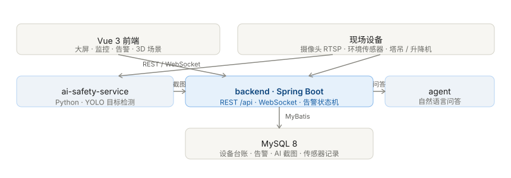

# Smart Site 智慧工地安全智能监控平台

面向建筑工地的一体化安全管理平台：设备台账、塔吊/升降机实时监控、环境与传感器采集、AI 视频识别告警、喷淋降尘联动、3D 场景大屏，以及一个能自然语言问答的运维智能体。

后端 Spring Boot 3 + MyBatis + MySQL，前端 Vue 3 + Three.js，AI 侧为 Python 服务（YOLO 检测 + 智能体）。

> 模型文件与演示视频体积较大，未纳入仓库，本地运行需要自行准备。

## 系统结构



## 目录结构

```
smart-site/
├── backend/             Spring Boot 后端（Java 17）
│   ├── sql/             建表脚本
│   └── src/main/java/com/qst/smartbuildings/
│       ├── controller/  20 个 REST 控制器
│       ├── service/     业务层
│       ├── mapper/      MyBatis 映射
│       ├── interceptor/ 登录与权限拦截
│       └── aop/         操作日志切面
├── frontend/            Vue 3 控制台（含 3D 场景与数据大屏）
├── ai-safety-service/   Python 视频识别服务（YOLO）
├── agent/               运维问答智能体（工具调用 + 流式输出）
├── ai_image/            AI 截图处理
├── mock_scripts/        模拟数据脚本
└── vedio_mock/          视频流模拟
```

## 功能模块

| 模块 | 说明 |
|---|---|
| 设备台账 | 设备类型、位置、资产设备三级管理，支持父子设备 |
| 实时监控 | 塔吊、升降机的运行参数曲线与环境指标 |
| 环境监测 | 传感器数据采集、历史记录与阈值告警 |
| AI 视频告警 | 摄像头视频流识别，生成告警截图并进入告警流程 |
| 告警处置 | 生成 → 推送 → 接单 → 处置 → 恢复的完整状态流转 |
| 喷淋联动 | 扬尘/PM2.5 超阈值时自动触发喷淋 |
| 3D 场景 | Three.js 场景编辑，设备坐标与状态实时映射 |
| 数据大屏 | 汇总看板，WebSocket 实时刷新 |
| 智能问答 | 自然语言查询设备状态、告警趋势 |

## 快速开始

### 1. 数据库

```bash
mysql -u root -p smartbuilding < backend/sql/20260814_asset_device_sensor_parent_type_v14.sql
```

### 2. 后端

```bash
cd backend
cp src/main/resources/application-dev.example.yml src/main/resources/application-dev.yml
# 编辑 application-dev.yml，填入自己的数据库和 Redis 连接信息
mvn spring-boot:run
```

默认端口 `8080`，接口前缀 `/api`。

### 3. 前端

```bash
cd frontend
npm install
npm run dev
```

### 4. AI 服务（可选）

```bash
cd ai-safety-service
pip install -r requirements.txt
# 模型文件需自行放入 models/ 目录
python app.py
```

## 配置说明

`application-dev.yml` 与 `.env` 含数据库密码等敏感信息，**已被 `.gitignore` 排除**。仓库里只提供 `*.example.yml` / `.env.example`，复制后自行填写。

## 技术栈

- 后端：Java 17、Spring Boot 3.0、MyBatis、MySQL、Redis、JWT
- 前端：Vue 3、Vite、Pinia、Element Plus、ECharts、Three.js
- AI：Python、YOLO、向量检索
